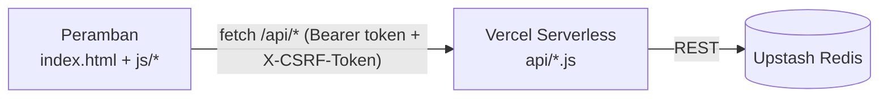

# Arsitektur

## Gambaran Umum

AKSARA terdiri dari halaman statis dan lima serverless function. Peramban memanggil `/api/*`, function di Vercel membaca dan menulis data ke Upstash Redis lewat REST.

Tidak ada langkah build. Vercel menyajikan berkas statis apa adanya dan mengubah setiap berkas di `api/` (kecuali yang berawalan `_`) menjadi endpoint. Setiap function dibatasi 10 detik (`vercel.json`).

Tanpa variabel Redis, setiap endpoint menjawab `{"configured":false}` dan frontend berjalan dalam **mode lokal** (data di localStorage peramban).

## Endpoint API

| Endpoint | Metode | Akses | Fungsi |
| --- | --- | --- | --- |
| `/api/auth` | `POST` | Publik | Login. Body `{e, p}`. `e="owner"` + `OWNER_KEY` menjadi owner, email admin + kata sandi menjadi admin, email pembeli + kata sandi menjadi user. Berhasil menjawab token sesi `tok` dan token CSRF `csrf`. Gagal selalu menjawab `{ok:false}` yang sama agar tidak membocorkan siapa yang punya akun. |
| | `POST {act:"reg"}` | Publik | Daftar akun pembeli `{n, e, p}` (nama ≥ 2 karakter, email valid, kata sandi 8 sampai 128 karakter berisi huruf dan angka). Dibatasi 8 pendaftaran per jam per IP, maksimum 5000 akun. |
| | `GET` | Sesi | Cek sesi: `{role, e, n}`. |
| | `PATCH` | Sesi (user) | Ubah nama pembeli `{n}`. |
| | `DELETE` | Sesi | Keluar (menghapus sesi). |
| `/api/content` | `GET` | Publik | `{configured:true, data:{about, contact, articles, prices}}`. |
| | `PUT` | Admin/owner | Simpan konten (teks Tentang dan Kontak, artikel, harga, stok). Semua input disanitasi dan dibatasi panjangnya. |
| `/api/inbox` | `POST` | Publik | Kirim pertanyaan. Dibatasi 5 pesan per 10 menit per IP, ada honeypot anti-bot, maksimum 2000 pesan. Setiap pesan mendapat token rahasia. |
| | `GET ?ids=id.token,...` | Publik | Pengunjung melihat balasan untuk pesannya sendiri (id dan token harus cocok). |
| | `GET ?all=1` | Admin/owner | Semua pesan (token disembunyikan). |
| | `PATCH` | Admin/owner | Membalas pesan. |
| | `DELETE ?id=` | Admin/owner | Menghapus pesan. |
| `/api/finance` | `GET`, `PUT` | Admin/owner | Modal per produk dan daftar BOP. Tidak pernah dikirim ke pengunjung. |
| `/api/staff` | `GET` | Owner | Daftar admin. |
| | `POST` | Owner | Mengangkat admin `{n, e, p}` (nama ≥ 2 karakter, email valid, kata sandi 10 sampai 128 karakter, maksimum 50 admin). |
| | `DELETE ?e=` | Owner | Mencopot admin. Sesinya langsung tidak berlaku. |
| (bukan endpoint) | | | `api/_lib.js`: helper bersama. |

## Sesi dan Wewenang

1. Login berhasil menghasilkan token acak 64 karakter heksadesimal. Server hanya menyimpan **hash**-nya di Redis (`ak:ses:<hash>`) selama 8 jam.
2. Klien mengirim token sebagai `Authorization: Bearer <token>`. Token disimpan di tab peramban (`sessionStorage`).
3. Setiap sesi juga punya **token CSRF** acak 256 bit (disimpan di sesi server). Setiap permintaan yang mengubah data (`POST`, `PUT`, `PATCH`, `DELETE`) dengan sesi wajib membawa header `X-CSRF-Token` yang sama. Sesi lama tanpa token CSRF dijawab 401 dan diminta masuk ulang.
4. `gate(req, res, min)` di `api/_lib.js` memeriksa sesi untuk setiap endpoint terlindung. `min` bernilai `admin` (admin atau owner) atau `owner` (hanya owner). Sesi berperan `user` (pembeli) selalu ditolak (403) di endpoint admin.
5. Saat admin dicopot atau akun pembeli dihapus, sesinya otomatis gugur karena `who()` mengecek akunnya masih terdaftar.

## Kunci Redis

| Kunci | Tipe | Isi |
| --- | --- | --- |
| `ak:content` | string (JSON) | Teks Tentang, Kontak, artikel, harga, stok |
| `ak:fin` | string (JSON) | Modal produk dan BOP |
| `ak:msgs` | hash | Pesan inbox |
| `ak:admins` | hash | Akun admin (email → data, kata sandi di-hash scrypt) |
| `ak:users` | hash | Akun pembeli (email → data, kata sandi di-hash scrypt) |
| `ak:ses:*` | string | Sesi aktif (kedaluwarsa 8 jam) |
| `ak:rl:*` | string | Penghitung pembatas laju |

## Keamanan

- **Kata sandi.** Admin dan pembeli di-hash dengan scrypt (N=2^15, r=8, p=3) beserta salt acak 16 byte per akun, di `api/_lib.js`. Hash lama (N=2^14) otomatis dinaikkan saat login berhasil. `OWNER_KEY` dibandingkan dengan `timingSafeEqual`. Pada mode lokal (tanpa Redis), kata sandi pembeli di-hash PBKDF2-SHA256 600.000 putaran di peramban.
- **CSRF.** Dua lapis. (1) Semua permintaan pengubah data, termasuk yang tanpa login, hanya diterima bila `Origin` atau `Sec-Fetch-Site` berasal dari situs sendiri dan isinya `application/json`. (2) Permintaan dengan sesi wajib membawa `X-CSRF-Token` yang cocok dengan token sesi (dibandingkan dengan `timingSafeEqual`).
- **Akun pembeli.** Didaftarkan dan masuk lewat `/api/auth`. Akun lama yang hanya ada di peramban dipindahkan ke server saat pemiliknya login, lalu hash lamanya dihapus dari peramban.
- **Pembatasan login.** 10 kegagalan dalam 10 menit dari satu IP mengunci login selama 10 menit (HTTP 429, "Terlalu banyak percobaan").
- **Email tidak peka huruf besar/kecil.** Server mengubahnya menjadi huruf kecil, jadi `Owner` dan `owner` dianggap sama.
- **Server yang menentukan.** Tampilan admin di peramban hanya antarmuka. Setiap penulisan diperiksa wewenangnya di server.
- **Sanitasi input.** Karakter kontrol dibuang, panjang dibatasi, URL hanya `http(s)`.
- **Header keamanan** (`vercel.json`): CSP yang membatasi skrip ke `self` dan cdnjs, `connect-src 'self'`, `X-Frame-Options: DENY`, `X-Content-Type-Options: nosniff`, `Referrer-Policy`, serta `form-action 'self'`, `base-uri 'self'`, dan `object-src 'none'`.
- **Tidak ada cache pada API.** Semua jawaban API memakai `Cache-Control: no-store`.
- **Rahasia di luar repo.** `.env*` dan `.vercel/` masuk `.gitignore`. Hanya `.env.example` yang boleh di-commit.

## Batasan Saat Ini

- Pesanan, keranjang, dan pembayaran masih simulasi di localStorage dan tidak dibagi antar pengguna. Stok di server tidak berkurang saat pesanan dibuat.
- Produk baru yang ditambah admin lewat panel masih lokal. Hanya harga dan stok produk yang ada di `js/data.js` yang disinkronkan.
- `database/schema.sql` adalah skema PostgreSQL untuk versi backend penuh di masa depan, belum dipakai oleh versi ini.
- Animasi buku 3D di beranda sudah diringankan untuk perangkat mobile (resolusi render adaptif, bayangan diperbarui bergantian, tanpa blur latar di navigasi), tetapi pada sebagian perangkat masih bisa sedikit tersendat.
